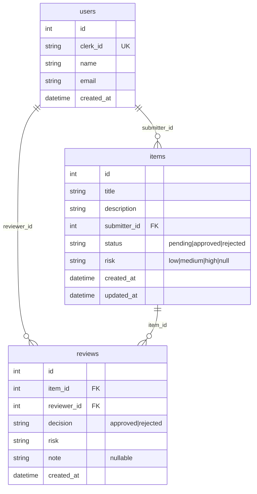

# Review Queue

A small full-stack app where signed-in users submit items to a review queue and review them, one at a time or in bulk (approve or reject, assign a risk level, add an optional note). The backend is a Laravel REST API that stores data in JSON files. The frontend is a Vue 3 single-page app. Authentication is handled by [Clerk](https://clerk.com).

```
backend/    Laravel API (PHP 8.4+)
frontend/   Vue 3 + Vite + TypeScript SPA, Vitest unit tests, Playwright E2E tests
Makefile    install / dev / test / e2e shortcuts
```

## Architecture

### Backend layers

Requests flow top to bottom. Each layer only talks to the one below it.

```
Route -> Controller -> Form Request (validation) -> Service (business rules)
      -> Repository interface -> JSON storage driver
                   \-> API Resource (response shape)
```

| Layer | Location | Responsibility |
| --- | --- | --- |
| Controllers | `app/Http/Controllers/Api` | Thin: call a service, return a resource. |
| Form Requests | `app/Http/Requests` | Validate and normalise input (including `filter[...]` rules contributed by each filter). |
| Services | `app/Services` | Business rules: submitting, reviewing, partial-success bulk review. |
| Query pipeline | `app/Queries` | Pluggable filters and sorts, state scopes, search. |
| Repositories | `app/Repositories` | Storage interfaces (`Contracts`) and their JSON implementations (`Json`). Bound in `RepositoryServiceProvider`, so the storage backend can be swapped. |
| Storage | `app/Storage` | Atomic, concurrency-safe JSON file access. |
| Domain, DTOs, Enums | `app/Domain`, `app/DTOs`, `app/Enums` | Plain entities, value objects, `ItemStatus`, `ReviewDecision`, `RiskLevel`. |
| Resources | `app/Http/Resources` | JSON shape of items, reviews and users. |
| Auth | `app/Auth`, `app/Http/Middleware` | `auth.clerk` middleware verifies the Clerk session JWT against Clerk's JWKS and upserts the user on first request. |

All errors share one JSON shape, `{ "message", "code", "errors"? }`, produced in `bootstrap/app.php`. Illegal actions never return a 500, and 500s carry a generic message with no stack trace.

### Frontend layers

| Layer | Location | Responsibility |
| --- | --- | --- |
| API client | `src/api` | Typed HTTP client, attaches the Clerk token, maps errors to `ApiError`. |
| Composables | `src/composables` | Data fetching (with request cancellation), debounce, URL query-state sync, selection. |
| Stores | `src/stores` | Pinia store for filter metadata. |
| Components | `src/components` | UI (shadcn-vue in `ui/`), queue, item and common components, `ErrorBoundary`. |
| Views | `src/views` | Route components: queue, item detail, submit, sign-in, not found. |
| Types | `src/types` | API types. |

The queue state (tab, search, filters, sort, page, page size) lives in the URL query, so every view is shareable and survives a reload.

### JSON storage and data model

Data lives in `backend/storage/app/data/` (override with `JSON_STORAGE_PATH`) as `users.json`, `items.json` and `reviews.json`. Relations use foreign IDs. Missing or empty files are treated as empty collections and created on first write. Writes take an exclusive `flock`, write to a temp file and rename it over the original, so they are atomic. Each file is read at most once per request. A corrupt file produces a generic 500 and is logged.



Timestamps are stored in UTC ISO-8601 and shown in the browser's local time.

## Prerequisites

- PHP 8.4+ and Composer: `brew install php composer`
- Node.js 24+ (or a recent LTS) and [pnpm](https://pnpm.io)
- A [Clerk](https://clerk.com) application and one test user (identified by email) in that application (used by the E2E suite).

## Environment variables

Copy the example files (`make install` does this for you) and fill in the values. Real `.env` files are git-ignored and must never be committed.

### `backend/.env`

| Variable | Description |
| --- | --- |
| `APP_KEY` | Generated by `php artisan key:generate` (`make install` runs it). |
| `CLERK_SECRET_KEY` | Clerk secret key. Also used by the E2E suite for `@clerk/testing`. |
| `CLERK_JWKS_URL` | Your Clerk instance's JWKS URL, e.g. `https://<your-instance>.clerk.accounts.dev/.well-known/jwks.json`. |
| `CLERK_ISSUER` | Your Clerk issuer (frontend API URL). Tokens with another issuer are rejected. |
| `CLERK_AUTHORIZED_PARTIES` | Comma-separated frontend origins allowed in the token `azp` claim. Default `http://localhost:5173`. |
| `CORS_ALLOWED_ORIGINS` | Comma-separated origins allowed by CORS. Default `http://localhost:5173`. |
| `JSON_STORAGE_PATH` | Optional data directory. Default `storage/app/data`. |

### `frontend/.env`

| Variable | Description |
| --- | --- |
| `VITE_CLERK_PUBLISHABLE_KEY` | Clerk publishable key. Without it the app shows a configuration error. |
| `VITE_API_BASE_URL` | Backend API base URL. Default `http://localhost:8000/api`. |
| `E2E_CLERK_USER_USERNAME` | Email address of the Clerk test user. Playwright signs in as this user with a Clerk sign-in token created via `CLERK_SECRET_KEY`. |
| `E2E_CLERK_USER_PASSWORD` | Password of the test user. Not used by the current E2E sign-in, kept for password-based flows. |
| `E2E_FRONTEND_PORT`, `E2E_BACKEND_PORT` | Optional ports for the E2E servers. Defaults `5199` and `8099`. |

## Running the app

| Command | What it does |
| --- | --- |
| `make install` | Installs Composer and pnpm dependencies, creates `.env` files from the examples, generates `APP_KEY`, installs the Playwright Chromium browser. |
| `make dev` | Starts the API on `http://localhost:8000` and the SPA on `http://localhost:5173`. |
| `make test` | Backend Pest tests, then frontend Vitest tests. |
| `make e2e` | Playwright end-to-end suite (see below). |
| `make lint`, `make format`, `make typecheck` | Pint and ESLint/Prettier, and `vue-tsc`. |

To load demo data (about 50 items in mixed states): `cd backend && php artisan app:seed-json`. Options: `--count=N`, `--fresh` (delete existing data first), `--seed=N` (deterministic output).

### End-to-end tests

`make e2e` starts its own backend (port `8099`) and frontend (port `5199`) with an isolated temp data directory, seeds 30 items, signs in once as the Clerk test user (`@clerk/testing`) and runs the specs in `frontend/e2e/specs`. The config loads `frontend/.env` and `frontend/.env.local`, and reads `CLERK_SECRET_KEY` from `backend/.env` when it is not already set. The E2E backend overrides `JSON_STORAGE_PATH`, `CORS_ALLOWED_ORIGINS` and `CLERK_AUTHORIZED_PARTIES` for the E2E ports, and uses the `file` cache store so it does not need a database.

If the Clerk variables are missing, the Clerk-dependent specs are skipped with a message naming the missing variables, and `make e2e` still succeeds. If the API answers 401 after sign-in, check `CLERK_ISSUER` and `CLERK_JWKS_URL` in `backend/.env`.

## API reference

All endpoints are under `/api` and require `Authorization: Bearer <Clerk session JWT>`, except `/api/health`. Responses use `{ "data": ... }`, and lists add `meta` with `current_page`, `per_page`, `total`, `last_page`.

| Method and path | Params | Description | Errors |
| --- | --- | --- | --- |
| `GET /api/health` | none | Liveness check. | none |
| `GET /api/me` | none | The current user. | 401 |
| `GET /api/items` | `state` (`pending`, `reviewed`, `all`; default `all`), `filter[key]`, `sort` (`created_at`, `updated_at`, `title`, `risk`, prefix `-` for descending), `page` (default 1), `per_page` (1-100, default 15) | Paginated item list. | 401, 422 |
| `GET /api/items/search` | `q` (max 100 chars; blank behaves like the list), plus the same params as `GET /api/items` | Case-insensitive search on title and description. | 401, 422 |
| `GET /api/items/filters` | none | Metadata for the available filters (key, label, type, options) and sorts. The UI builds its controls from it. Returns `{ filters, sorts }`. | 401 |
| `GET /api/items/{id}` | none | Item detail with submitter and latest review. | 401, 404 |
| `GET /api/items/{id}/reviews` | `page`, `per_page` | Paginated review history of an item. | 401, 404, 422 |
| `POST /api/items` | `title` (required, 3-120 chars), `description` (required, max 5000) | Submit a new item, created as `pending`. Returns 201. | 401, 422 |
| `POST /api/items/reviews` | `ids[]` (1-100, de-duplicated), `decision` (`approved`, `rejected`), `risk` (optional: `low`, `medium`, `high`), `note` (optional, max 1000) | Bulk review with partial success. Returns 200 with `data: { updated: [...items], failed: [{ id, reason }] }` and `meta: { updated_count, failed_count }`. Failure reasons: `not_found`, `already_reviewed`. The detail page uses this endpoint with one ID. | 401, 422 |

Error responses always look like `{ "message", "code", "errors"? }`:

| Status | `code` | When |
| --- | --- | --- |
| 401 | `unauthenticated` | Missing or invalid token. |
| 404 | `not_found` | Unknown item or route. |
| 405 | `method_not_allowed` | Wrong HTTP method. |
| 409 | `conflict` | Action conflicts with the current state. |
| 422 | `validation_failed` | Invalid input, including an unknown `filter` key, invalid `sort` or `per_page`. `errors` maps fields to messages. |
| 500 | `server_error` | Unexpected failure (generic message, no stack trace). |

Out-of-range `page` values return 200 with an empty `data` array and correct `meta`.

Available filters: `status`, `risk`, `submitter` (mine or everyone), `created_from`, `created_to`.

## How to add a filter

A filter is one class plus one line in the registry.

1. Create a class in `backend/app/Queries/Filters` that implements `App\Queries\Filters\Contracts\Filter`:

   ```php
   class PriorityFilter implements Filter
   {
       public function key(): string { return 'priority'; }            // the filter[priority] param

       public function rules(): array { return ['nullable', 'string']; } // validation for the value

       public function apply(Collection $items, mixed $value, QueryContext $ctx): Collection
       {
           return $items->filter(fn ($item): bool => /* keep matching items */);
       }

       public function meta(): array                                    // drives the UI control
       {
           return ['key' => 'priority', 'label' => 'Priority', 'type' => 'select', 'options' => [/* value, label */]];
       }
   }
   ```

2. Register it with one line in `backend/config/item_query.php`:

   ```php
   'filters' => [
       // ...
       PriorityFilter::class,
   ],
   ```

Validation, the `/api/items/filters` metadata and the filter control in the queue UI pick it up automatically. Sorts work the same way: implement `Sorts\Contracts\Sort` and add it to the `sorts` list.
