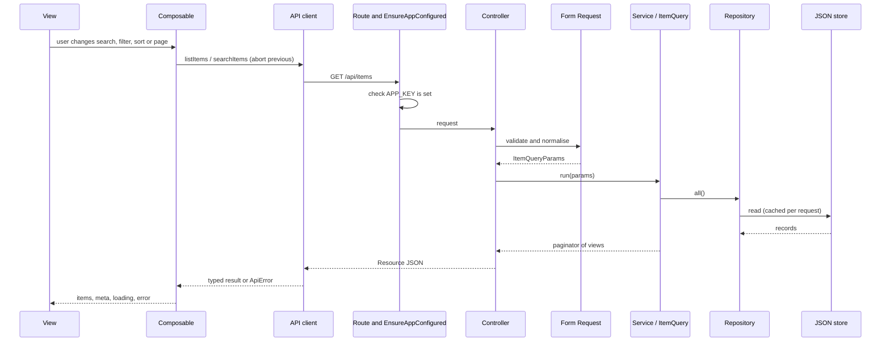
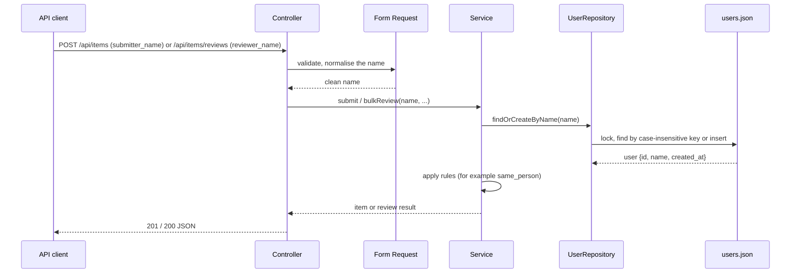

# Architecture

How the backend and frontend are layered and how a request flows through them.

## Contents

- [Request flow](#request-flow)
- [Backend layers](#backend-layers)
- [Frontend layers](#frontend-layers)
- [Design notes](#design-notes)

## Request flow



Writes add a name resolution step. A submit or review request carries a typed name, and the service turns it into a user before doing anything else:



There is no authentication step: no middleware identifies the caller. See [Identity and names](identity-and-names.md).

## Backend layers

Requests flow top to bottom; each layer only talks to the one below it.

```text
Route -> Controller -> Form Request (validation) -> Service (business rules)
      -> Repository interface -> JSON store
                   \-> API Resource (response shape)
```

| Layer | Location | Responsibility |
| --- | --- | --- |
| Routes | `routes/api.php`, `routes/api/items.php` | Map URLs to controllers; `/health` is open and the item routes sit behind `EnsureAppConfigured`. |
| Middleware | `app/Http/Middleware` | `EnsureAppConfigured` answers `503` when `APP_KEY` is missing. There is no auth middleware. |
| Controllers | `app/Http/Controllers/Api` | Thin: call a form request, a service or the query, return a resource. |
| Form Requests | `app/Http/Requests` | Validate and normalise input, including person names (`app/Support/PersonName`). `ListItemsRequest` pulls `filter[...]` rules from every registered filter. |
| Services | `app/Services` | Business rules: submitting an item, partial-success bulk review, the self-review rule. Both resolve the typed name through `UserRepository::findOrCreateByName`. |
| Query pipeline | `app/Queries` | `ItemQuery` applies the (API-only) state scope, search, filters, sort and pagination; `FilterRegistry` and `SortRegistry` are built from `config/item_query.php`. |
| Repositories | `app/Repositories` | Interfaces in `Contracts`, JSON implementations in `Json`, bound in `RepositoryServiceProvider`. |
| Storage | `app/Storage` | `JsonStore`: atomic, lock-protected file access. |
| Domain, DTOs, Enums | `app/Domain`, `app/DTOs`, `app/Enums` | Plain entities, value objects, `ItemStatus`, `ReviewDecision`, `RiskLevel`. |
| Resources | `app/Http/Resources` | JSON shape of items and reviews (with the submitter and reviewer names). |
| Errors | `bootstrap/app.php`, `app/Exceptions` | One handler maps every exception to the `{message, code, errors?}` contract. |

## Frontend layers

| Layer | Location | Responsibility |
| --- | --- | --- |
| Views | `src/views` | Route components: queue, item detail, submit, not found. |
| Components | `src/components` | UI building blocks: `ui/` (shadcn-vue), `queue/`, `item/`, `items/`, `common/` (including `ErrorBoundary`), `layout/`. |
| Composables | `src/composables` | Data fetching with request cancellation, debounce, URL query-state sync, selection. |
| Stores | `src/stores` | Pinia store caching filter metadata. |
| API client | `src/api` | Typed `fetch` wrapper that maps failures to `ApiError`. |
| Lib and types | `src/lib`, `src/types` | Error messages, person-name helpers, shared API types. |

Views use components and composables; composables call the API client; nothing above the API client builds URLs.

## Design notes

- The queue state (search, filters, sort, page, page size) lives in the URL query, not in component state. `useQueryState` parses and normalises it, so every view is shareable and survives a reload.
- Filters and sorts are plugins. Adding one touches one class and one config line; see [Filters and sorting](filters-and-sorting.md).
- Storage sits behind repository interfaces, so the JSON store could be replaced without touching services; see [Data model](data-model.md).
- Search is debounced by 300 ms and in-flight requests are aborted when the query changes.
