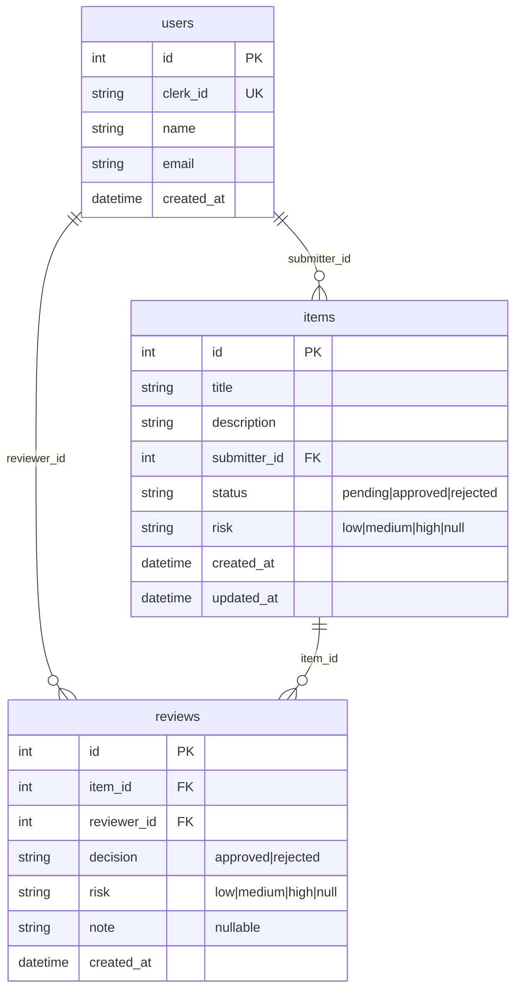

# Data model

The JSON files that hold all data, their fields and relations, and how writes stay safe.

## Contents

- [Files and location](#files-and-location)
- [Entity relationships](#entity-relationships)
- [Fields](#fields)
- [Enums](#enums)
- [Atomic writes and locking](#atomic-writes-and-locking)
- [Resetting data](#resetting-data)

## Files and location

Data lives in `backend/storage/app/data/` (override with `JSON_STORAGE_PATH`) as three files: `users.json`, `items.json` and `reviews.json`. Each file is a JSON list of records with integer ids. A missing or empty file is treated as an empty collection and is created on first write. A `<name>.lock` sidecar file is created next to each collection for locking.

## Entity relationships



## Fields

`users.json`:

| Field | Type | Notes |
| --- | --- | --- |
| `id` | integer | Auto-incremented. |
| `clerk_id` | string | Clerk user id (`sub` claim). Unique. |
| `name` | string | From the token's `name` claim, falling back to the Clerk id. |
| `email` | string | From the token's `email` claim; may be empty. |
| `created_at` | string | UTC ISO-8601. |

`items.json`:

| Field | Type | Notes |
| --- | --- | --- |
| `id` | integer | Auto-incremented. |
| `title` | string | 3 to 120 characters. |
| `description` | string | Up to 5000 characters. |
| `submitter_id` | integer | References `users.id`. |
| `status` | string | `pending`, `approved` or `rejected`. |
| `risk` | string or null | Set by a review. |
| `created_at`, `updated_at` | string | UTC ISO-8601. `updated_at` changes on review. |

`reviews.json`:

| Field | Type | Notes |
| --- | --- | --- |
| `id` | integer | Auto-incremented. |
| `item_id` | integer | References `items.id`. |
| `reviewer_id` | integer | References `users.id`. |
| `decision` | string | `approved` or `rejected`. |
| `risk` | string or null | The item's risk after the review. |
| `note` | string or null | Up to 1000 characters. |
| `created_at` | string | UTC ISO-8601. |

An item is reviewed at most once: a review moves it from `pending` to `approved` or `rejected`, and later attempts are reported as `already_reviewed`. The API presents `latest_review` and the review history from the `reviews` file.

## Enums

| Enum | Values | Notes |
| --- | --- | --- |
| `ItemStatus` | `pending`, `approved`, `rejected` | `approved` and `rejected` count as reviewed. |
| `ReviewDecision` | `approved`, `rejected` | Maps to the resulting item status. |
| `RiskLevel` | `low`, `medium`, `high` | Sort weight 1, 2, 3. A missing risk sorts last. |

## Atomic writes and locking

`app/Storage/JsonStore.php` guards every write:

1. Open the sidecar `<collection>.lock` file and take an exclusive `flock`. The data file itself cannot hold the lock because it is replaced by rename.
2. Read the current records fresh from disk (not from the per-request cache).
3. Run the mutation.
4. Write the result to a temporary file in the same directory, then `rename` it over the data file. Readers see either the old or the new file, never a partial one.
5. Release the lock.

Reads are cached per request, so each file is read at most once. Nested transactions on the same collection join the outer one, which is how a bulk review updates items and creates reviews under one lock. A corrupt file (invalid JSON or a non-list) raises a storage exception, is logged, and is returned as a generic `500 server_error`.

## Resetting data

```bash
cd backend
php artisan app:seed-json --fresh --count=50
```

`--fresh` deletes the three data files first, `--count=N` sets the number of items (default 50) and `--seed=N` makes the output deterministic. Seeded users have Clerk ids like `seed_user_1`.
